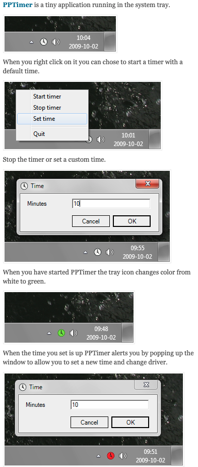

# Pair programming timer 

A pair programming timer that sits in the system tray / menu bar. Set a number of minutes, and when time is up it gongs and asks for the next round, so it's time to switch driver.

Originally a C# WinForms app developed 2009 (devblog: https://pptimer.wordpress.com/). Ported in 2026 to .NET 10 + [Avalonia](https://avaloniaui.net/), so it now runs on macOS, Windows and Linux.

## Running

Requires the [.NET 10 SDK](https://dotnet.microsoft.com/download).

```sh
dotnet run --project PPTimer
```

Look for the clock icon in the menu bar (macOS) or system tray (Windows/Linux) and use its menu: **Start timer**, **Stop timer**, **Set time**, **Quit**. Hover the icon to see how much time is left.

### macOS app

```sh
tools/package-macos.sh            # Apple Silicon; use osx-x64 for Intel Macs
```

This builds `build/PPTimer.app`, a menu bar only app (no Dock icon). Drag it to `/Applications`. It is signed ad hoc, not notarized, so on another Mac the first launch needs right-click → **Open**.

### Windows / Linux

```sh
dotnet publish PPTimer -c Release -r win-x64 --self-contained     # or linux-x64
```

Then run `PPTimer.exe` / `PPTimer` from the publish folder.

The tray and app icons are drawn by `tools/draw-icons.py`.

Sound is played with the OS's own player: `PlaySound` on Windows, `afplay` on macOS, `paplay`/`aplay` on Linux. Tray icons on Linux need a desktop with StatusNotifier/AppIndicator support.

## Screenshots (original 2009 version)

